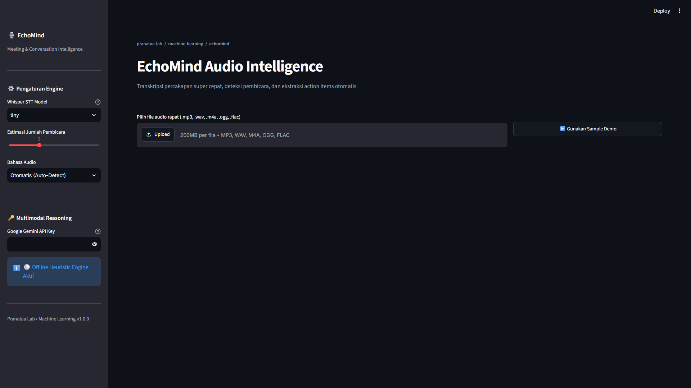

# 🎙️ EchoMind — Meeting & Audio Intelligence Platform

[`python`](https://github.com/topics/python) • [`faster-whisper`](https://github.com/topics/faster-whisper) • [`gemini-api`](https://github.com/topics/gemini-api) • [`streamlit`](https://github.com/topics/streamlit) • [`audio-intelligence`](https://github.com/topics/audio-intelligence) • [`speech-to-text`](https://github.com/topics/speech-to-text) • [`meeting-summarizer`](https://github.com/topics/meeting-summarizer) • [`cpu-inference`](https://github.com/topics/cpu-inference)

**EchoMind** adalah platform analitik audio dan rapat modern end-to-end yang menggabungkan transkripsi ucapan super cepat (*Speech-to-Text*) dengan penalaran kecerdasan multimodal (*Multimodal Intelligence*).

Proyek ini dibangun untuk mendeteksi pembicara, mentranskripsikan ucapan secara real-time, mengekstraksi **Action Items** (tugas, penanggung jawab, tenggat waktu), meringkas hasil rapat, menganalisis dinamika sentimen, dan menyediakan asisten interaktif untuk tanya jawab seputar isi rekaman.

---

## Tangkapan Layar Aplikasi

<p align="center">
  
</p>

---

## 🌟 Fitur Utama

- **🚀 High-Speed Speech-to-Text (STT):** Didukung oleh `faster-whisper` dengan arsitektur CTranslate2 dan kuantisasi `int8`, berjalan sangat cepat dan hemat daya langsung di CPU (optimal untuk laptop/PC tanpa GPU diskrit).
- **👥 Speaker Turn Detection & Timestamps:** Pemisahan giliran bicara (*speaker turns*) beserta penanda waktu presisi detik demi detik.
- **✅ Automated Action Items Extraction:** Secara cerdas mendeteksi komitmen tugas, PIC (penanggung jawab), tenggat waktu, dan tingkat urgensi (High/Medium/Low).
- **📌 Executive Summary & Key Decisions:** Meringkas poin-poin krusial dan kesepakatan formal dalam format eksekutif.
- **💬 Ask-Your-Meeting (Interactive Q&A):** Chatbot kontekstual yang dapat menjawab pertanyaan seputar jalannya rapat lengkap dengan rujukan timestamp.
- **📊 Sentiment & Emotion Analytics:** Analisis suasana percakapan (apakah rapat berjalan positif, alot, atau tegang).
- **🔄 Dual Engine Mode:** Mendukung **Google Gemini 2.5 Flash** untuk deep contextual reasoning, serta **Offline Heuristic Mode** jika tanpa koneksi API.
- **🎨 Modern Slate Dashboard:** Antarmuka web interaktif berbasis Streamlit yang mengadopsi estetika *Shadcn Slate*.

---

## 🏗️ Struktur Proyek

```
mechine-learning/
├── app.py                     # Entrypoint Web Dashboard Streamlit
├── echomind/
│   ├── __init__.py
│   ├── config.py              # Konfigurasi model dan environment
│   ├── schemas.py             # Pydantic schemas untuk data terstruktur
│   ├── audio/
│   │   ├── __init__.py
│   │   └── processor.py       # Audio inspection, conversion, temp files
│   ├── stt/
│   │   ├── __init__.py
│   │   └── transcriber.py     # Engine faster-whisper dengan kuantisasi INT8
│   ├── intelligence/
│   │   ├── __init__.py
│   │   ├── prompts.py         # System prompt eksekutif & Q&A
│   │   └── analyzer.py        # Gemini 2.5 Flash & Offline Heuristic Engine
│   └── utils/
│       ├── __init__.py
│       └── helpers.py         # Export CSV/Markdown, formatting timestamps
├── sample_data/
│   ├── make_sample.ps1        # Generator audio demo via Windows SAPI
│   └── sample_meeting.wav     # File audio sampel demo bawaan
├── test_pipeline.py           # Script verifikasi otomatis pipeline
├── requirements.txt           # Dependensi Python
└── README.md
```

---

## 🚀 Cara Menjalankan

### 1. Prasyarat
- Python 3.11 atau 3.12
- Rekomendasi manajer paket: `uv` (atau `pip`)

### 2. Jalankan Aplikasi
Jalankan dashboard Streamlit dengan perintah:

```powershell
.venv\Scripts\streamlit run app.py
```

Dashboard akan otomatis terbuka di browser Anda (`http://localhost:8501`).

### 3. Menggunakan Sample Audio Bawaan
Anda tidak perlu repot mencari rekaman suara! Cukup klik tombol **`▶️ Pakai Sample Audio Demo`** di bagian kanan atas aplikasi, lalu klik tombol **`🚀 Mulai Transkripsi & Analisis Cerdas`**.

### 4. (Opsional) Mengaktifkan Gemini API
Untuk hasil penalaran konteks terbaik:
1. Buat API Key gratis di [Google AI Studio](https://aistudio.google.com).
2. Masukkan ke input form di sidebar aplikasi atau simpan di file `.env`:
   ```env
   GEMINI_API_KEY=your_gemini_api_key_here
   ```
*(Jika tidak dimasukkan, aplikasi tetap berjalan 100% menggunakan Offline Heuristic Engine).*

---

## 📦 Ekspor Laporan

- **Action Items (.csv):** Dapat diunduh dan langsung diimpor ke Excel, Notion, atau Trello.
- **Executive Report (.md):** Laporan rapat lengkap siap kirim ke email atau arsip tim.
